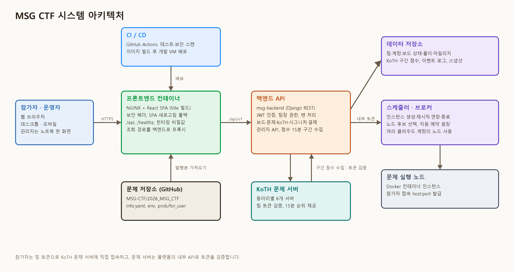
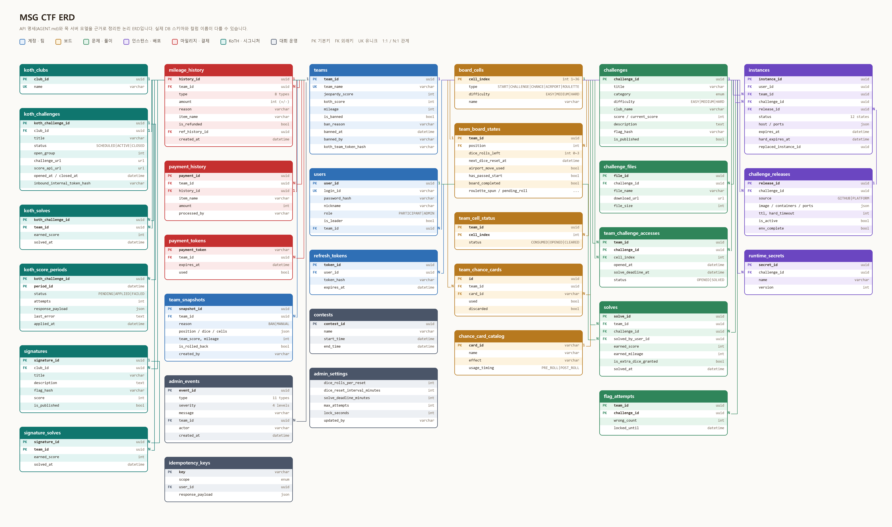
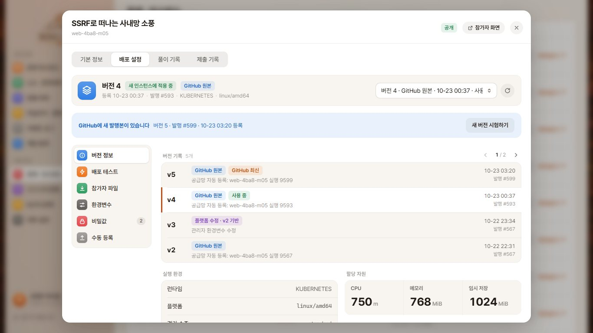
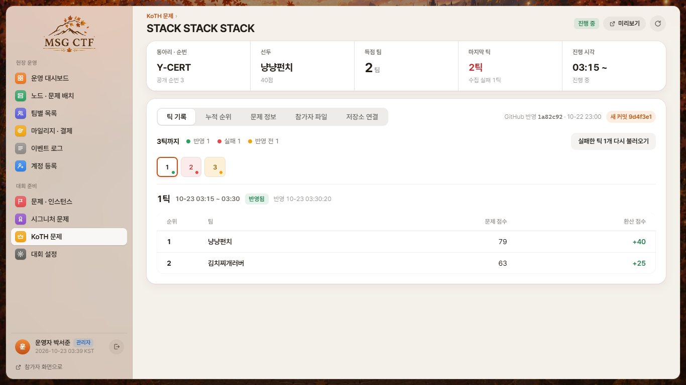

# 🍁 MSG CTF — Frontend

가을 축제 콘셉트의 CTF(Capture The Flag) 대회 **MSG CTF**의 프론트엔드 저장소입니다.
팀이 주사위를 굴려 보드 위를 이동하고, 칸마다 열리는 문제를 풀며, 동아리 부스와 KoTH(King of the Hill) 문제까지 함께 즐기는 웹 서비스입니다.

> API 명세·기획 문서 전체는 [`AGENT.md`](AGENT.md)에 있습니다. 이 README는 화면별 기능을 설명하는 상세 안내서입니다.

---

## Technology Stack

**Language**


-3776AB?style=flat-square&logo=python&logoColor=white)

**Frontend**


**Mock Backend / Infra**


**Design**


---

## 목차
1. [프로젝트 소개](#프로젝트-소개)
2. [개발 과정](#개발-과정)
3. [기능 상세](#기능-상세)
4. [시스템 아키텍처](#시스템-아키텍처)
5. [ERD](#erd)
6. [화면 구성](#화면-구성)
7. [폴더 구조](#폴더-구조)
8. [실행 방법](#실행-방법)

---

<a id="프로젝트-소개"></a>
## 🎯 프로젝트 소개

MSG CTF는 2026년 11월 8일 서울 종로 교원챌린지홀에서 열리는 연합 동아리 CTF 대회의 운영 플랫폼입니다. 참가비는 무료이고 접수는 HSPACE에서 받습니다. 참가자는 팀 단위로 로그인하며, 회원가입 화면은 없고 운영자가 미리 등록한 계정을 나눠 줍니다. 팀은 모두의마블처럼 36칸 보드판 위에서 주사위를 굴려 말을 움직이고, 도착한 칸에서 고른 문제를 15분 안에 풀면 점수와 마일리지, 추가 주사위를 받습니다. 보드 밖에서는 동아리 여섯 곳의 부스에서 시그니처 문제를 풀고, 15분 단위로 점수가 쌓이는 KoTH(King of the Hill) 문제에 도전하며, 모은 마일리지는 QR 결제로 부스에서 사용합니다.

이 저장소는 그중 **참가자와 운영자가 보는 웹 프론트엔드**입니다. React 단일 페이지 앱이고, 같은 `/api` 경로 아래의 백엔드와 통신합니다. 백엔드가 없는 환경에서도 화면을 확인할 수 있도록 Django로 만든 목 서버(`mock-backend/`)를 함께 두었습니다. API 계약과 기획 변경 이력은 [`AGENT.md`](AGENT.md)에, 기능별 검증 기록은 [`docs/`](docs)에 있습니다.

---

<a id="개발-과정"></a>
## 📆 개발 과정

PR 기록(#1~#164)을 기준으로 정리했습니다.

- 2026.08.19: 저장소 시작, KoTH와 규칙 페이지 UI 1차 구현
- 2026.08.26~29: 스코어보드, 마이페이지, 목 백엔드 추가 및 Figma 디자인 작업 시작
- 2026.08.29~09.07: Figma 시안을 보드, 문제 상세, 관리자 화면 6종의 React 코드로 변환
- 2026.08.30~09.13: 로그인, 보드, 문제 상세, 리더보드, KoTH, 타이머, 마이페이지 실제 API 연동과 CI 구축
- 2026.09.14~20: 열린 문제 목록, 찬스카드, 마일리지 QR, 홍보·참가 안내 페이지, 개발 서버 자동 배포
- 2026.09.28: 관리자 API 연동 확대, 기차여행·룰렛·열린 문제 패널 시안 반영, 보드판 주사위 3D 모션 구현
- 2026.09.29~30: 물리 엔진 기반 주사위 굴림, 기차 이동 모션과 경적·증기 효과, 문제 카드 선택 연출
- 2026.10.01~05: 라인 독점 표시, 보드 렌더링 부하 개선, 링크 공유 미리보기, 무인도 칸을 룰렛 칸으로 교체
- 2026.10.06~16: 문제 상세·마이페이지 Figma 재적용, 동아리 축제장과 부스 메뉴판 모달, 황금열쇠 카드 디자인
- 2026.10.08~21: 관리자 문제 배포 설정 구축 (GitHub 발행본 가져오기, 환경변수, 배포 테스트, 실행 설정)
- 2026.10.12~21: 서버 로그인 검증 라우트, 보안 헤더, 모바일 배치와 초기 로딩 성능 개선
- 2026.10.22~23: 관리자 콘솔 개편(노드·문제 배치), KoTH 관리 화면, 부스 플래그 제출 추가
- 2026.10.23~: 보드판 말 점핑 모션, 좌상단 패널 통합 등 마무리와 QA

---

<a id="기능-상세"></a>
## ⚙️ 기능 상세

화면 접근 정책은 이렇습니다. 홍보 페이지, 참가 안내, 로그인만 로그인 없이 열 수 있고, 나머지 게임·관리자 화면은 서버의 로그인 확인이 성공한 뒤에만 코드와 데이터를 불러옵니다. 관리자 권한은 브라우저에 저장된 값이 아니라 서버가 내려 준 `role`로만 판단합니다.

### 홍보 · 참가 안내 (`/`, `/guide`)
대회 소개 페이지입니다. 첫 화면에 대회 일시와 장소, 시작까지 남은 시간을 보여 주고, 아래로 내려가며 대회 개요, 진행 방식, 상금, 동아리 부스 구성, 마일리지 상점, 행사장 안내와 지도, 지난 대회 기록, 신청 방법, 후원사·주최 로고를 차례로 소개합니다. 상금은 총 200만원이며 내부 트랙 30·20·10만원, 외부 트랙 50·30·10만원에 안랩 대표상 50만원이 더해집니다. `/guide`는 현장에서 필요한 참가 안내만 따로 모은 페이지이고, 링크를 메신저에 공유하면 대회 이름과 이미지가 미리보기로 나오도록 빌드 단계에서 메타 정보를 넣습니다.

### 로그인 (`/login`)
아이디와 비밀번호로 로그인합니다. 로그인하면 1시간짜리 액세스 토큰과 12시간짜리 리프레시 토큰을 받고, 만료되면 화면이 알아서 토큰을 갱신합니다. 관리자 계정은 `/admin`으로, 참가자는 `/board`로 이동합니다. 밴된 팀도 로그인은 되며 이유가 안내됩니다. 짧은 시간에 로그인을 반복해 실패하면 서버가 요청을 제한합니다. 브라우저 자동 완성이 켜져 있어도 배경 그림이 깨지지 않게 처리했고, 작은 화면에서도 원본 그림 비율을 유지합니다.

### 대회 시작 전 대기 화면
대회 시작 시각 전에 보드, 문제, 부스, KoTH, 스코어보드로 들어오면 카운트다운만 보여 주고, 서버 시각 기준으로 시작되는 순간 저절로 화면을 엽니다. 규칙, 마이페이지, 타이머와 관리자 계정은 시작 전에도 들어갈 수 있습니다.

### 보드 (`/board`)
서비스의 중심 화면입니다. 원형으로 놓인 36칸에는 출발, 문제, 찬스, 기차(Airport), 룰렛의 다섯 종류가 있고, 문제 칸은 난이도(EASY·MEDIUM·HARD)가 정해져 있습니다. 칸마다 마우스를 올리거나 선택하면 종류와 난이도, 내 팀의 방문 상태를 설명하는 정보창이 열립니다. 이미 지나온 칸은 어둡게 표시되고, 문제를 연 칸과 푼 칸은 서로 다르게 보입니다. 같은 분야의 칸을 이어 묶은 라인은 보드 바깥 레일로 그려 주며, 라인 문제를 모두 풀어 독점하면 레일 색이 바뀌고 보너스 점수가 표시됩니다.

**주사위.** 굴리기 기회는 팀이 함께 쓰며 최대 3회를 들고 있습니다. 기회를 쓰면 15분마다 1회씩 충전되고, 현재 칸의 문제를 연 뒤 15분 안에 처음 풀면 1회를 더 받습니다. 어떤 보상을 받아도 3회를 넘지 않으며, 충전 도중에 더 쓰거나 보상을 받아도 이미 돌고 있는 충전 시각은 미뤄지지 않습니다. 주사위 굴리기와 이동 확정은 팀장만 할 수 있고, 팀원은 같은 화면을 보며 문제 선택과 풀이에 참여합니다. 주사위는 three.js로 그린 3D 주사위 두 개를 물리 엔진(cannon-es)으로 던지며, 계산은 웹 워커에서 하므로 화면이 멈추지 않습니다. 굴려진 눈의 합만큼 말이 한 칸씩 곡선을 그리며 점프해 이동하고, 이미 소모한 칸에 도착하면 같은 방향의 다음 빈 칸까지 진행합니다. 새로고침하거나 다른 브라우저로 접속해도 확인하지 않은 굴림 결과는 서버 기록으로 이어받으며, 재접속만으로 주사위를 낭비하지 않습니다.

**문제 선택.** 문제 칸에 도착하면 같은 난이도의 안 푼 문제 후보 최대 3개가 카드로 펼쳐집니다. 팀원 누구나 한 장을 골라 열 수 있고, 한 번 열면 그 칸에서 다시 고르지 않습니다. 문제를 열면 15분 타이머가 시작되며, 15분이 지나도 풀 수는 있지만 추가 주사위 보상은 받지 못합니다. 이미 연 칸을 다시 누르면 칸 정보창 대신 해당 문제 상세로 바로 이동합니다.

**특수 칸.** 출발 칸은 지나가면 100 마일리지를, 도착하면 주사위 1회를 줍니다. 찬스 칸(황금열쇠)에 도착하면 팀장이 카드 한 장을 뽑고 주사위 1회를 받습니다. 카드는 다섯 종류입니다. 주사위 다시 굴리기, 주사위 두 번 굴려 고르기, 주변 칸(±3)으로 이동, 세계여행(원하는 칸으로 이동), 주사위 보너스입니다. 카드는 굴리기 전이나 굴린 뒤 이동을 확정하기 전에 쓰며, 두 장째를 뽑으면 한 장을 버려야 합니다. 룰렛 칸은 2개이고 팀장이 룰렛을 돌려 50·100·150·200 마일리지 중 하나를 받습니다. 기차 칸에 도착하면 팀당 한 번 아직 안 쓴 원하는 칸을 골라 기차를 타고 이동할 수 있습니다. 기차는 증기와 경적 소리와 함께 속도를 내고 줄입니다.

**보드 위 보조 패널.** 왼쪽 위에는 주사위 상태(보유 N/3, 다음 충전까지 남은 시간, 막힌 이유), 보유 찬스카드, 열린 문제 버튼이 한 패널로 모여 있습니다. 열린 문제 패널은 양피지 모양으로 펼쳐지며 팀이 연 문제를 순서대로 보여 주고 푼 문제에는 확인 표시가 붙습니다. 오른쪽에는 스코어보드, 마이페이지, 규칙 같은 이동 버튼과 로그아웃, KoTH 배너, 동아리 부스 버튼이 있습니다. 화면 비율이 달라지거나 글자 크기를 키워도 보드와 패널이 겹치지 않도록 배치를 다시 계산합니다.

### 열린 문제 목록 (`/challenges`)
보드의 열린 문제 패널을 전체 화면으로 보는 페이지입니다. 제목이나 출제 동아리로 검색하고, 분야와 풀이 상태로 걸러 볼 수 있으며, 내가 띄워 둔 인스턴스로 바로 갈 수 있습니다. 문제 상세에서 돌아오면 필터와 스크롤 위치가 그대로 복원됩니다. 조회에 실패하면 빈 목록과 구분해 다시 불러오기를 안내합니다.

### 문제 상세 (`/challenges/:id`)
문제 제목, 분야, 난이도, 현재 배점, 출제 동아리, 설명, 첨부파일, 푼 팀 수를 보여 줍니다. 팀이 열지 않았거나 공개되지 않은 문제는 열람할 수 없습니다. 설명 속 드라이브 다운로드 링크는 바로 내려받을 수 있습니다. 서버가 필요한 문제라면 인스턴스를 만들 수 있고, 만든 뒤에는 준비 중, 실행 중, 오류, 만료 같은 상태와 접속 주소, 남은 시간이 실시간으로 갱신됩니다. 인스턴스는 사용자당 하나만 만들 수 있어 새로 만들면 기존 것이 교체되며, 초기화, 30분 연장(한도 있음), 종료 단추가 있습니다. 서버가 필요 없는 정적 문제에는 인스턴스 영역이 아예 나타나지 않고, 초기화 후 만료되었을 때는 이유를 안내합니다.

플래그는 제출 즉시 검증됩니다. 정답이면 획득 점수, 마일리지, 추가 주사위 지급 여부를 결과창에서 알려 주고, 오답을 3번 연속 제출하면 30초 동안 제출이 잠기며 남은 시간이 표시됩니다. 같은 문제를 다시 풀어도 점수가 중복으로 들어가지 않습니다. 배점은 푼 팀이 늘수록 내려가는 다이나믹 스코어링이라 풀이 당시 받은 점수와 현재 배점이 다를 수 있습니다.

### 동아리 부스 · 시그니처 (`/signatures`)
가을 축제장 그림 위에 여섯 동아리(MJSEC, SWING, Y-CERT, seKUrity, CodeCure, Aegis)의 천막이 놓여 있고, 천막을 누르면 해당 부스로 들어갑니다. 부스에는 메뉴판 모달이 열려 동아리 소개와 시그니처 문제 설명, 마일리지로 살 수 있는 메뉴가 보이며, 아래 플래그 제출 단추로 풀이 화면으로 넘어갑니다. 시그니처 문제는 배점이 낮고 대회 점수에 합산되며, 푼 문제는 풀이 완료로 표시됩니다. 공개된 문제가 없는 부스는 들어갈 수 없고, 여섯 곳 외의 동아리가 있으면 별도 입구로 표시합니다.

### KoTH (`/koth`)
동아리마다 한 문제씩 모두 6문제가 라운드를 나눠 차례로 열립니다. 각 문제는 공개 예정, 진행 중, 종료 중 하나의 상태이며, 현재 1위 팀과 점수가 보입니다. 우리 팀의 팀 토큰을 확인할 수 있고, 이 토큰을 문제 서버에 입력하면 서버가 팀을 알아봅니다. 진행 중이고 접속 주소가 등록된 문제만 접속 단추가 켜지며, 참가자 파일이 있으면 내려받을 수 있습니다. 점수는 15분 구간마다 문제 서버가 알려 준 순위로 매기는데, 1~5위가 40·25·15·12·8점이고 공동 순위는 합산 후 나눠 가집니다. 풀이 완료 도장과 문제별 순위표, 우리 팀의 누적 점수가 30초마다 갱신됩니다.

### 스코어보드 (`/leaderboard`)
위쪽에는 상위 8개 팀의 누적 점수 그래프가 있고, 팀마다 문제를 푼 시각에 점이 찍혀 직선으로 이어집니다. 점수는 제오파디와 KoTH 점수를 합한 값입니다. 아래쪽 팀 랭킹 표는 페이지를 넘겨 가며 전체 팀을 볼 수 있고, 점수가 같으면 먼저 푼 팀이 위로 오릅니다. 그래프와 표는 30초마다 함께 갱신되고, 일부 요청이 실패하면 마지막 정상 값을 유지한 채 다시 조회하라고 안내합니다. 화면을 확대하거나 휴대폰을 가로로 돌려도 그래프 글자와 조작 단추가 읽히도록 맞춰 두었습니다.

### 마이페이지 (`/mypage`)
한 화면에 팀 이름과 팀원 목록(팀장 표시), 총점과 제오파디·KoTH 점수, 팀 순위와 개인 순위, 현재 마일리지, 밴 여부가 모여 있습니다. 풀이 기록에서는 푼 문제, 획득 점수, 푼 사람, 푼 시각을 볼 수 있고, 마일리지 내역에서는 문제 풀이, 출발 보너스, 룰렛, 관리자 지급, 부스 구매, 환불 같은 유형별로 들어오고 나간 값을 확인합니다. 부스에서 결제할 때 쓰는 QR 코드는 이곳에서 발급되며 5분 안에만 유효하고 다시 발급하면 이전 것은 무효가 됩니다. 소속 팀이 없는 계정에는 오류 대신 안내가 나오고, 팀이 바뀌면 이전 정보와 QR이 사라집니다.

### 타이머와 규칙 (`/timer`, `/rules`)
타이머는 대회 시작 전, 진행 중, 종료 상태와 남은 시간을 서버 시각에 맞춰 초 단위로 보여 줍니다. 규칙 페이지는 주사위, 출발 칸, 찬스 칸, 룰렛 칸, 기차 칸의 규칙을 룰북 모양으로 정리하며, 보드의 버튼으로 열고 닫을 수 있습니다.

### 관리자 (`/admin/*`)
운영자가 대회 당일 노트북 한 화면에서 쓰도록 만든 콘솔로, 왼쪽 메뉴에서 아래 화면을 오갑니다. 상세 화면 캡처는 [`docs/admin-console.md`](docs/admin-console.md)에 있습니다.

- **운영 대시보드(`/admin`)**: 대회 남은 시간, 실행 중·실패 인스턴스 수, 참가 팀 수, 선두 팀, 부스 결제 현황을 위에 두고, 아래에 노드 현황, 실패·지연 인스턴스, 최근 운영 기록, 빠른 작업을 모았습니다. 30초마다 새로고침됩니다.
- **팀 관리(`/admin/teams`, `/admin/teams/:id`)**: 팀을 검색하고 점수나 이름순으로 정렬합니다. 상세에서는 팀원과 마일리지 요약, 최근 내역을 보고 팀을 밴하거나 해제하며, 팀 이름과 팀원, 팀장을 바꾸고 팀을 삭제합니다. 보드에 문제가 생긴 팀을 위해 말 위치 이동, 칸 상태(소모·열림·해결) 수정, 주사위 지급·회수, 스냅샷 시점으로 롤백도 할 수 있습니다. 모든 조작에는 사유를 적고, 기록은 이벤트 로그에 남습니다.
- **문제 관리(`/admin/challenges`)**: 문제 목록과 인스턴스 현황, 공개·비공개 전환, 문제 만들기, 풀이·제출 기록(오답과 잠금 포함)을 다룹니다. 문제마다 배포 버전(릴리스)을 관리하는데, GitHub 발행본을 골라 가져오고, 저장소 환경변수와 플랫폼에서 고친 값, 이전 기록을 구분해 보여 주며, 못 채운 환경변수가 있는 버전은 사용을 막습니다. 새 버전은 참가자 버전을 그대로 둔 채 관리자 전용 배포 테스트로 먼저 띄워 볼 수 있고, 채점용 플래그와 실행 환경, 참가자에게 주는 파일을 설정합니다. 문제를 참가자 화면 그대로 미리 볼 수도 있습니다.
- **시그니처 관리(`/admin/signatures`)**: 동아리별 시그니처 문제를 만들고 고치며 공개 여부를 정합니다. 배점을 바꿀 때는 한 번 더 확인합니다.
- **KoTH 관리(`/admin/koth`)**: 문제를 직접 등록하거나 저장소의 koth 폴더에서 가져오고, 15분 구간(틱)별 순위·문제 점수·환산 점수를 확인합니다. 수집에 실패한 구간은 다시 불러오고, 접속 주소와 채점 주소를 저장하기 전에 연결을 시험하며, 참가자 파일 묶음과 공개 순번, 상태를 바꿉니다. 참가자 화면 미리보기도 있습니다.
- **마일리지 · 결제(`/admin/mileage`)**: 전체 마일리지 내역을 유형별로 거르고, 부스에서 참가자의 QR을 카메라로 스캔해 결제하며, 결제를 환불합니다. 요청이 겹쳐도 한 번만 처리되도록 멱등 키를 보냅니다.
- **노드 · 문제 배치(`/admin/resources`)**: 클라우드 계정별 노드의 CPU·메모리·디스크 사용률과 예약 자원을 보고, 노드마다 어떤 문제가 몇 개 올라가 있는지 팀별 인스턴스까지 펼쳐 봅니다. 계정별로 대회 종료까지의 예상 요금을 보고 새 배치를 멈출 수 있으며, 문제 인스턴스를 강제로 재시작하거나 종료합니다.
- **대회 설정(`/admin/settings`)**: 대회 시작·종료 시각, 주사위 충전 횟수와 간격, 문제 풀이 제한 시간, 플래그 오답 제한 횟수와 잠금 시간을 바꿉니다. 이미 시작한 대회의 시작 시각은 바꾸지 못합니다.
- **이벤트 로그(`/admin/logs`)**: 관리자 조작과 시스템 이벤트를 유형과 심각도, 팀으로 걸러 봅니다.
- **계정 등록(`/admin/accounts`)**: 아이디, 비밀번호, 닉네임, 역할, 팀장 여부, 소속 팀을 입력해 참가자 계정을 만들며, 없는 팀 이름을 쓰면 팀도 함께 만듭니다.

### 공통 사항
요청이 실패하면 서버가 보낸 오류 코드를 사람이 읽을 수 있는 문장으로 바꿔 보여 줍니다. 쓰기 요청은 같은 요청이 두 번 처리되지 않도록 멱등 키를 붙이며, 서버가 응답하지 않을 때도 화면이 깨지지 않게 이전 값을 유지합니다. 모바일에서는 원본 그림의 비율을 지키면서 목록과 패널을 다시 배치하고, 숨겨진 탭에서는 주기적 갱신을 멈춥니다. 모든 화면은 코드 분할로 필요할 때만 받으며, `node --test` 단위 테스트와 `scripts/qa-*.js`의 화면 검수 스크립트가 보드 배치, 반응형, 글꼴, 접근 제어, 성능을 확인합니다.

---

<a id="시스템-아키텍처"></a>
## 🛠️ 시스템 아키텍처

브라우저는 NGINX가 서빙하는 React 정적 파일을 받고, `/api`와 상태 확인 경로는 NGINX가 백엔드로 넘겨 줍니다. 백엔드는 팀·보드·풀이·마일리지 데이터를 저장하고, 문제 인스턴스는 스케줄러와 브로커를 거쳐 실행 노드에 띄웁니다. KoTH는 동아리별 문제 서버가 15분마다 순위를 알려 주며 팀 토큰도 백엔드에 확인합니다. 문제 원본은 GitHub 저장소에서 가져옵니다. 프론트는 GitHub Actions가 테스트와 보안 검사를 거친 뒤 이미지를 만들어 개발 서버에 배포합니다.



---

<a id="erd"></a>
## 📝 ERD

계정·팀, 보드, 문제·풀이, 인스턴스·배포, 마일리지·결제, KoTH·시그니처, 대회 운영의 일곱 묶음으로 나눠 색을 달리했습니다. 프론트 저장소에는 실제 DB 스키마가 없어서 `AGENT.md`의 API 명세와 `mock-backend/api/models.py`를 근거로 정리한 논리 ERD이며, 컬럼 이름은 실제 백엔드와 다를 수 있습니다. 이미지는 `python scripts/render-erd.py`로 다시 만들 수 있습니다.



---

<a id="화면-구성"></a>
## 🖼️ 화면 구성

| 페이지 | 경로 | 접근 |
|---|---|---|
| 홍보 · 참가 안내 | `/`, `/guide` | 누구나 |
| 로그인 | `/login` | 누구나 |
| 보드 | `/board` | 로그인 |
| 열린 문제 · 문제 상세 | `/challenges`, `/challenges/:id` | 로그인 |
| 동아리 부스 | `/signatures`, `/signatures/clubs/:id` | 로그인 |
| KoTH | `/koth` | 로그인 |
| 스코어보드 | `/leaderboard` | 로그인 |
| 마이페이지 | `/mypage` | 로그인 |
| 타이머 · 규칙 | `/timer`, `/rules` | 로그인 |
| 관리자 | `/admin/*` | 관리자 |

### 보드


### 열린 문제 목록


### 문제 상세


### 동아리 축제장과 부스


### KoTH


### 마이페이지


### 규칙


### 대회 시작 전 대기


### 관리자 대시보드


### 관리자 노드 · 문제 배치


### 관리자 문제 배포 버전


### 관리자 KoTH


---

<a id="폴더-구조"></a>
## 📁 폴더 구조

```text
.
├── src/
│   ├── api/            # axios 클라이언트와 API별 요청 함수
│   ├── features/       # 화면 단위 기능 (admin, auth, board, challenges, intro,
│   │                   #   koth, leaderboard, mypage, rules, signatures, timer)
│   ├── components/     # 공통 컴포넌트
│   ├── routes/         # 라우트 정의와 접근 제어
│   ├── utils/          # 시간·응답·폴링 유틸
│   └── styles/         # 공통 스타일
├── public/assets/      # 화면별 이미지·폰트
├── mock-backend/       # 로컬 연동 테스트용 Django 목 서버
├── build/              # 빌드 플러그인(공유 미리보기 메타)과 테스트
├── scripts/            # 이미지 최적화·QA 보조 스크립트
├── docs/               # 기능별 문서와 화면 검증 자료
├── archive/            # 초기 기획 문서 보관
├── AGENT.md            # 통합 기획·API 명세서
├── Dockerfile · docker-compose.yml · nginx.conf.template
└── .github/workflows/  # CI (테스트 · 보안 스캔 · 이미지 빌드)
```

---

<a id="실행-방법"></a>
## 🚀 실행 방법

```bash
# 프론트엔드
npm ci
npm run dev        # http://localhost:5173
npm test           # 단위 테스트
npm run build      # dist/ 정적 파일 생성
```

백엔드가 없을 때는 목 서버를 같이 띄웁니다. 개발 서버가 `/api`를 `http://127.0.0.1:8000`으로 전달합니다.

```bash
cd mock-backend
python -m venv venv && source venv/bin/activate   # Windows: venv\Scripts\activate
pip install -r requirements.txt
python manage.py migrate && python manage.py seed_demo_data
python manage.py runserver 127.0.0.1:8000
```

| 계정 | 비밀번호 | 비고 |
|---|---|---|
| `member1` | `password1` | Alpha팀 팀원 |
| `leader1` | `password1` | Alpha팀 팀장 |
| `admin1` | `admin1234` | 관리자 |

Docker로는 `docker compose up --build` 한 번이면 프론트(3000번)와 목 서버(8000번)가 함께 뜹니다.
