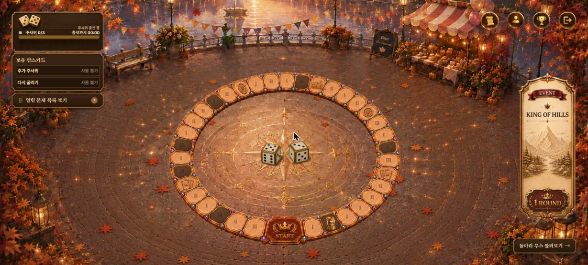
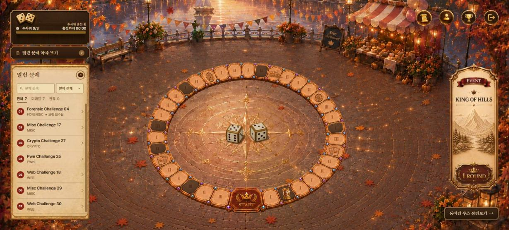
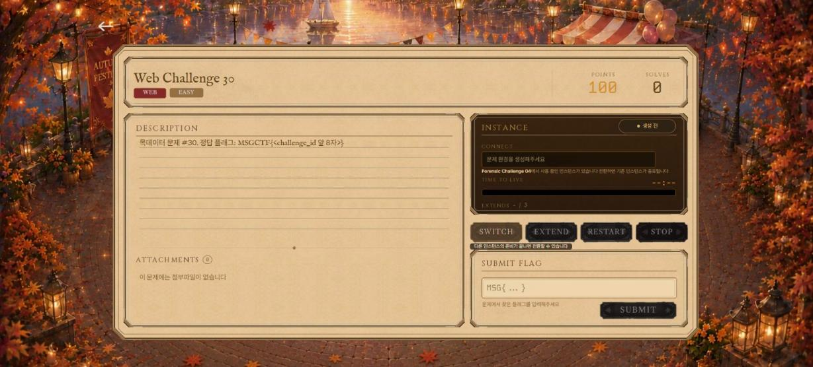
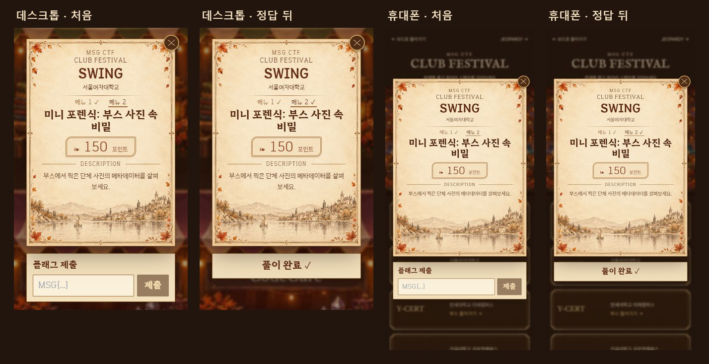
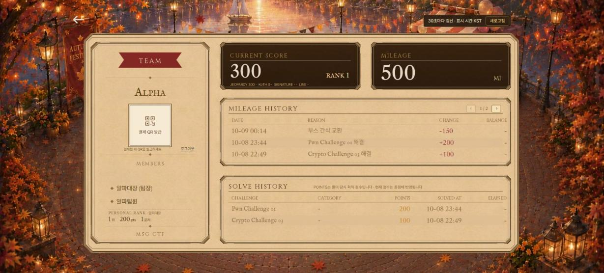
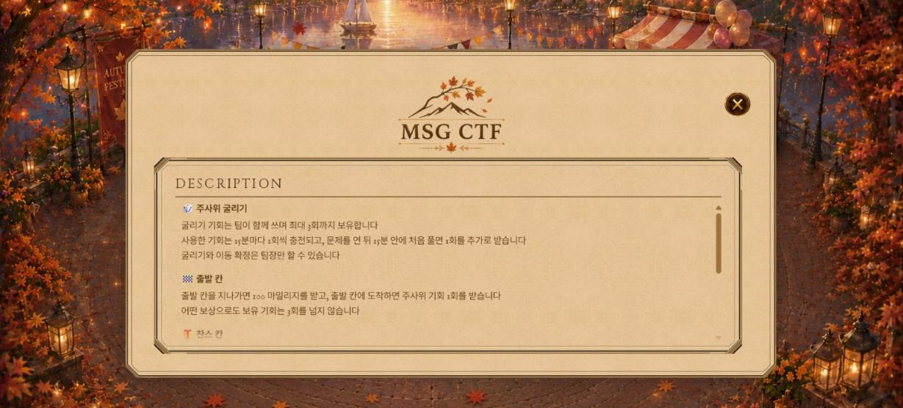
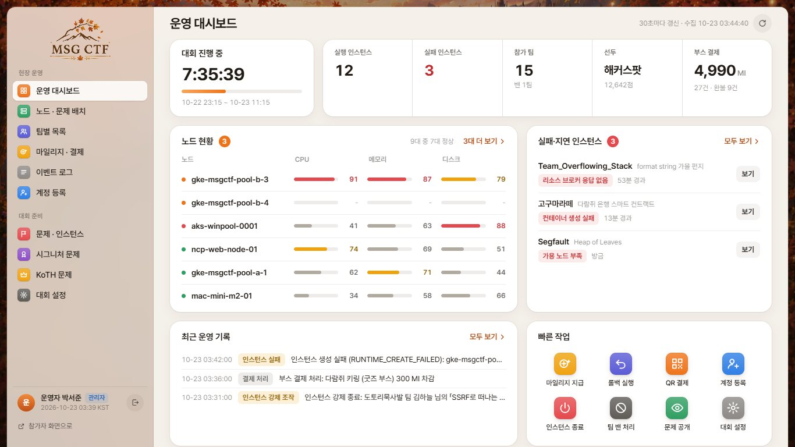

# 🍁 MSG CTF — Frontend

가을 축제 콘셉트의 CTF(Capture The Flag) 대회 **MSG CTF**의 프론트엔드 저장소입니다.
팀이 주사위를 굴려 보드 위를 이동하고, 칸마다 열리는 문제를 풀며, 동아리 부스와 KoTH(King of the Hill) 문제까지 함께 즐기는 웹 서비스입니다.

> API 명세·기획 문서 전체는 [`AGENT.md`](AGENT.md)에 있습니다. 이 README는 저장소를 처음 보는 사람을 위한 요약입니다.

---

## Technology Stack

**Language**


-3776AB?style=flat-square&logo=python&logoColor=white)

**Frontend**


**Mock Backend / Infra**


**Design**


---

## 목차
1. [화면 구성](#화면-구성)
2. [폴더 구조](#폴더-구조)
3. [실행 방법](#실행-방법)

---

<a id="화면-구성"></a>
## 🖼️ 화면 구성

| 페이지 | 경로 | 설명 |
|---|---|---|
| 홍보 · 참가 안내 | `/`, `/guide` | 대회 소개와 참가 안내 (로그인 없이 열람) |
| 로그인 | `/login` | 팀 계정 로그인 |
| 보드 | `/board` | 주사위·이동·이벤트가 모이는 메인 게임 화면 |
| 열린 문제 · 문제 상세 | `/challenges`, `/challenges/:id` | 칸에서 연 문제 목록, 인스턴스 생성과 플래그 제출 |
| 동아리 부스 | `/signatures` | 동아리 6곳 부스에서 시그니처 문제 풀이 |
| KoTH | `/koth` | 라운드별 King of the Hill 문제 |
| 스코어보드 | `/leaderboard` | 점수 그래프와 팀 순위 |
| 마이페이지 | `/mypage` | 팀 정보, 마일리지·풀이 기록, 부스 결제 QR |
| 규칙 | `/rules` | 대회 규칙 안내 |
| 관리자 | `/admin/*` | 운영 대시보드, 팀·문제·인스턴스·KoTH 관리 |

### 보드
주사위 상태와 재충전 진행 바, 보유 찬스카드, 열린 문제 버튼이 왼쪽에 모이고, 가운데 원형 보드에서 말이 움직입니다.



### 열린 문제 목록
보드 위에서 바로 열려 있는 문제를 검색하고 분야별로 걸러 볼 수 있습니다.



### 문제 상세
문제 설명, 첨부파일, 인스턴스 제어, 플래그 제출이 한 화면에 있습니다.



### 동아리 부스
축제장에서 부스를 고르면 메뉴판 모달이 열리고, 모달 안에서 바로 플래그를 제출합니다.




### KoTH
세 라운드에 걸쳐 문제가 열리는 King of the Hill 안내 화면입니다.


### 마이페이지
팀 점수와 마일리지, 마일리지 내역, 풀이 기록을 한눈에 봅니다.



### 규칙


### 관리자 대시보드
대회 진행 시간, 노드·인스턴스 상태, 최근 운영 기록과 빠른 작업을 제공합니다.



---

<a id="폴더-구조"></a>
## 📁 폴더 구조

```text
.
├── src/
│   ├── api/            # axios 클라이언트와 API별 요청 함수
│   ├── features/       # 화면 단위 기능 (admin, auth, board, challenges, intro,
│   │                   #   koth, leaderboard, mypage, rules, signatures, timer)
│   ├── components/     # 공통 컴포넌트
│   ├── routes/         # 라우트 정의와 접근 제어
│   ├── utils/          # 시간·응답·폴링 유틸
│   └── styles/         # 공통 스타일
├── public/assets/      # 화면별 이미지·폰트
├── mock-backend/       # 로컬 연동 테스트용 Django 목 서버
├── build/              # 빌드 플러그인(공유 미리보기 메타)과 테스트
├── scripts/            # 이미지 최적화·QA 보조 스크립트
├── docs/               # 기능별 문서와 화면 검증 자료
├── archive/            # 초기 기획 문서 보관
├── AGENT.md            # 통합 기획·API 명세서
├── Dockerfile · docker-compose.yml · nginx.conf.template
└── .github/workflows/  # CI (테스트 · 보안 스캔 · 이미지 빌드)
```

---

<a id="실행-방법"></a>
## 🚀 실행 방법

```bash
# 프론트엔드
npm ci
npm run dev        # http://localhost:5173
npm test           # 단위 테스트
npm run build      # dist/ 정적 파일 생성
```

백엔드가 없을 때는 목 서버를 같이 띄웁니다. 개발 서버가 `/api`를 `http://127.0.0.1:8000`으로 전달합니다.

```bash
cd mock-backend
python -m venv venv && source venv/bin/activate   # Windows: venv\Scripts\activate
pip install -r requirements.txt
python manage.py migrate && python manage.py seed_demo_data
python manage.py runserver 127.0.0.1:8000
```

| 계정 | 비밀번호 | 비고 |
|---|---|---|
| `member1` | `password1` | Alpha팀 팀원 |
| `leader1` | `password1` | Alpha팀 팀장 |
| `admin1` | `admin1234` | 관리자 |

Docker로는 `docker compose up --build` 한 번이면 프론트(3000번)와 목 서버(8000번)가 함께 뜹니다.
