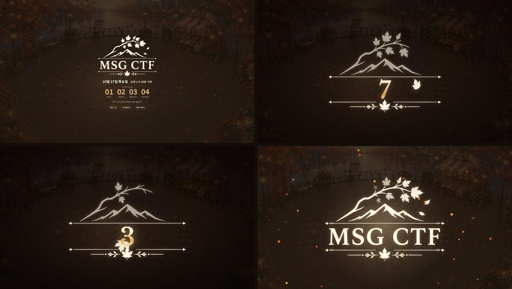
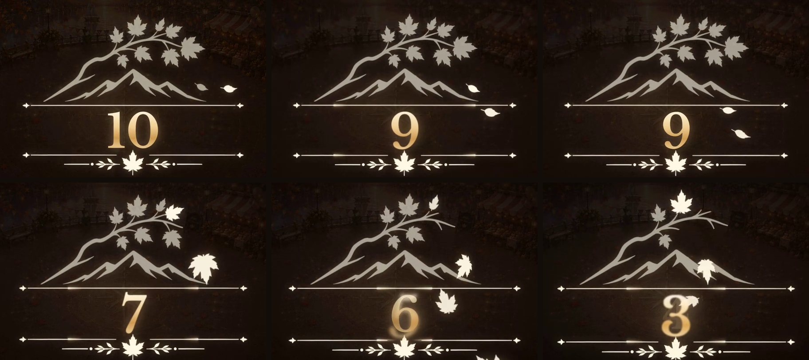
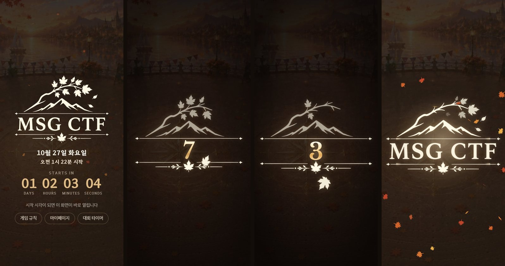
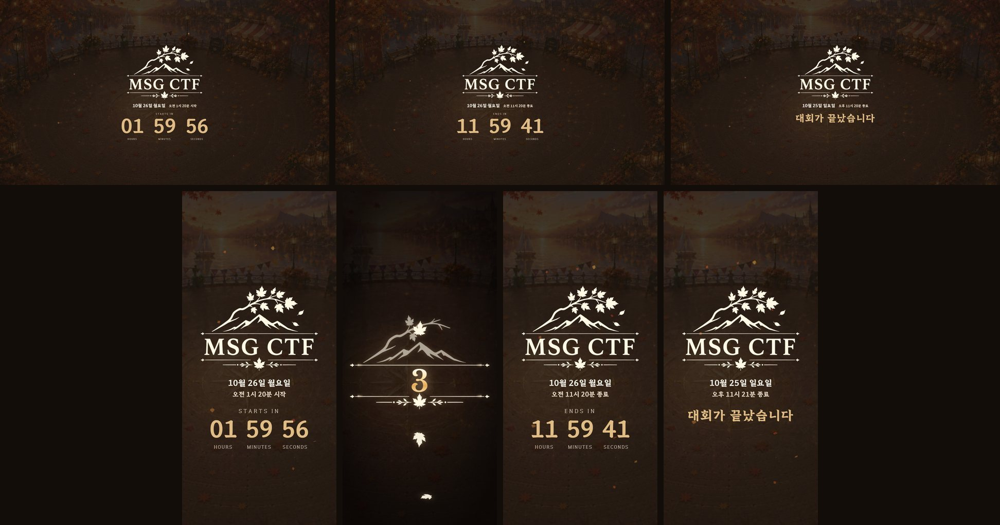
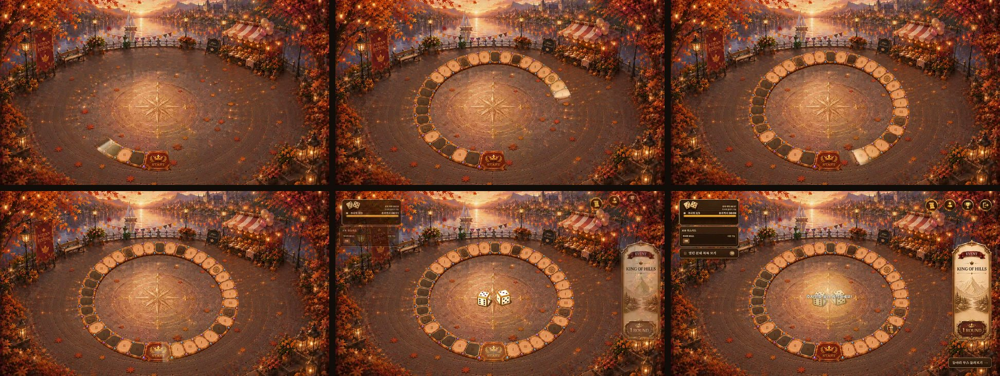
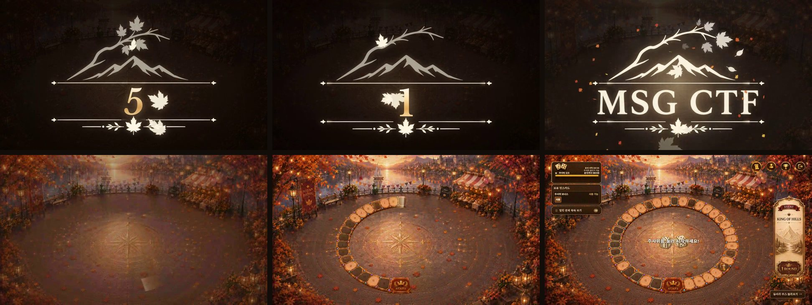

# 대회 시작 카운트다운과 판이 생기는 연출

대회 시작 전 대기 화면을 홍보 페이지 첫 화면처럼 바꾸고, 마지막 10초 카운트다운과 시작 연출, 같은 화면을 쓰는 대회 타이머, 보드에 처음 들어올 때 판이 생기는 연출을 넣었다
화면 캡처는 목 서버와 개발 미리보기 데이터다

## 대기 화면

- 시작 전에는 보드, 문제, 시그니처, KoTH, 순위 화면을 이 화면으로 막는다 관리자는 그대로 지나간다
- 홍보 페이지 첫 화면과 같은 광장, 로고, 날짜, STARTS IN 시계를 두고 게임 규칙, 마이페이지, 대회 타이머로 갈 수 있다
- 서버 시각을 기준으로 남은 초가 바뀌는 순간에 맞춰 센다 30초 넘게 남았으면 1분마다 서버 시각을 다시 받는다
- 기다리는 동안 열릴 화면의 코드를 미리 받아 두고, 시작 순간 화면 코드를 받는 동안에도 시작 연출은 멈추지 않는다

## 마지막 10초와 시작 연출

- 로고가 화면 가운데로 커지고 MSG CTF 글자 자리에 금색 숫자를 세운다 숫자는 로고 글자와 결이 맞는 Libre Baskerville 이고 3초부터 더 밝다
- 매초 장식 줄을 따라 빛이 달리고, 로고 가지에 달린 잎 10장이 1초에 한 장씩 크림색 그대로 떨어진다 1초에는 가지가 빈다
- 0초에는 MSG CTF 글자가 빛과 함께 돌아오고 잎이 다시 돋으며 퍼진다 그 뒤 로고가 흩어지고 막이 걷혀 게임 화면이 열린다
- 시작 연출은 투명도와 이동만 움직여서 뒤에서 게임 화면이 붙으며 바빠도 끊기지 않는다
- 잎과 가지 그림은 scripts/split-countdown-logo-leaves.py 가 홍보 로고에서 떼어 낸다 다시 합치면 원본과 같은지 스크립트가 확인한다

## 대회 타이머

- /timer 도 같은 무대에서 시작 전에는 시작까지, 진행 중에는 종료까지 센다 현장 화면에 띄우는 화면이라 버튼 없이 시계를 크게 둔다
- 시작과 종료 10초 전에는 같은 숫자 셈과 연출을 하고, 끝난 뒤에는 대회가 끝났습니다를 둔다
- 서버가 아직 시작 전이라고 답해도 시작 시각을 넘기면 바로 종료까지 센다 다시 불러오는 동안 시계가 멈추지 않는다
- 서버 시각을 못 받으면 이 기기 시계 기준이라고 적고, 30초마다 하는 재동기화가 잠깐 실패해도 받아 둔 시각으로 계속 센다

## 판이 생기는 연출

- 새 로그인 세션이나 대기 화면의 마지막 10초를 본 뒤 보드에 처음 들어오면 한 번 보인다 같은 세션에서 다시 들어오면 보이지 않는다
- 빈 광장에서 START 부터 금빛이 판을 시계 방향으로 돌며 칸을 드러내고, 다시 START 에 닿으면 빛난다 그 뒤 주사위와 말, 주변 판들이 들어오고 첫 주사위 안내가 뜬다
- 카운트다운에서 들어오면 시작 연출의 막이 걷히는 동안 기다렸다가 시작해서 숫자 셈, 시작 연출, 빈 광장, 판이 생기는 모습이 한 흐름으로 이어진다
- 3D 주사위 캔버스는 보이는 크기를 재서 그리므로 주사위와 판 전체에는 이동과 크기 변화를 주지 않는다 움직임은 판 그림과 빛 층에만 준다

## 개발 서버에서 보기

- /dev/countdown-preview 에서 대기 화면, 15초 전부터, 4초 전부터, 숫자 고정, 시작 연출, 타이머 시작과 종료 15초 전, 타이머 끝난 뒤를 바꿔 본다
- 시작 연출이 끝나면 뒤에 실제 보드가 열리고 판이 생기는 연출까지 이어서 볼 수 있다
