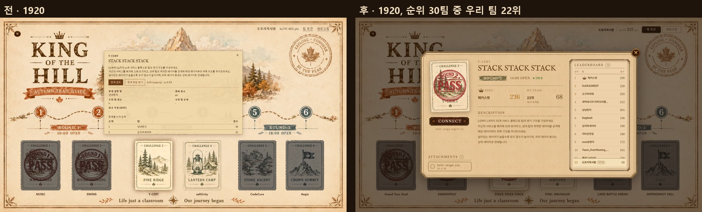
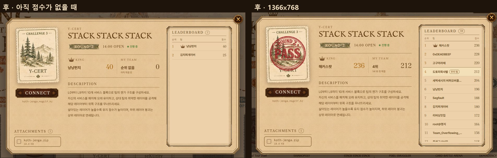
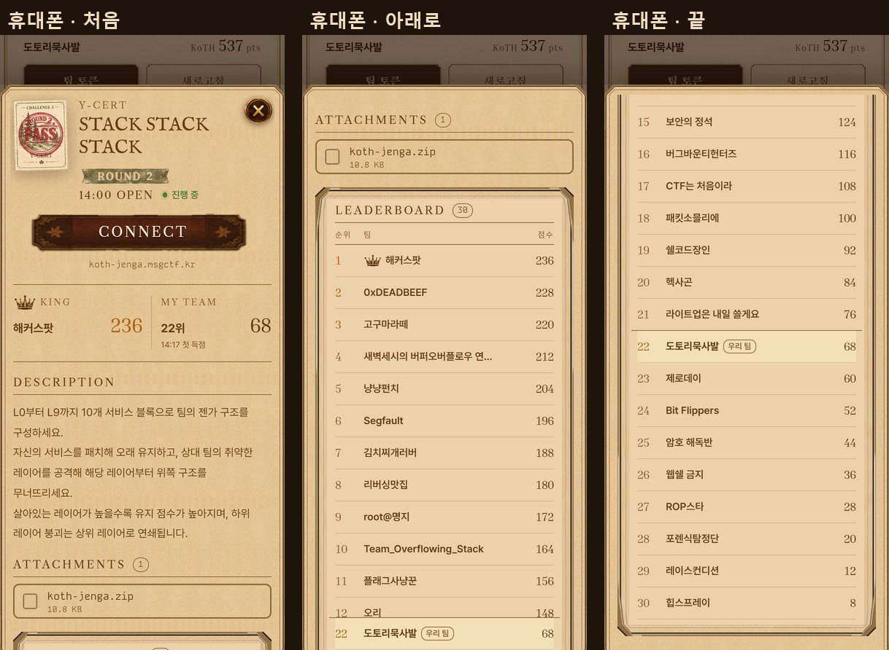
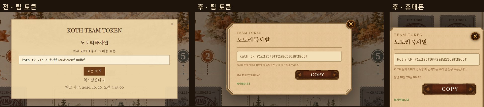
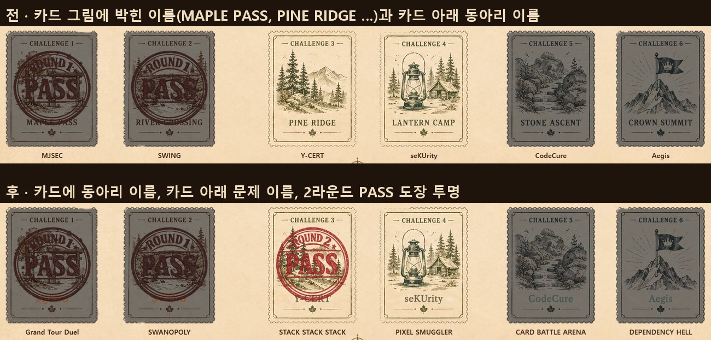

# KoTH 문제 창과 팀 토큰 창

KoTH 지도에서 문제를 누르면 뜨는 창이 작고 뒤 지도가 비쳐 읽기 어려워서, 문제 상세 화면과 같은 판 그림으로 큰 창을 다시 만들었다
팀 토큰 창도 같은 판으로 맞추고, 지도 카드에는 그림에 박힌 이름 대신 출제 동아리 이름을 얹었다
화면 캡처는 목 서버 데이터다

## 문제 창

- 지도 가운데에 1920 기준 1200x704 판으로 띄우고 뒤 지도는 어둡게 가린다 지도와 같이 줄되 노트북 화면에서는 기준 글자가 14px 아래로 내려가지 않는다
- 바깥 판, 순위 판 테두리, 소제목 글꼴, CONNECT 명판은 문제 상세 화면의 그림과 글꼴을 그대로 쓴다 안쪽 금테는 순위 판 하나만 둔다
- 왼쪽에 지도에서 고른 우표 카드를 크게 두고 그 아래에 CONNECT, 접속 주소, 첨부파일을 둔다
- 가운데에 동아리, 제목, 라운드 리본과 열린 시각, 진행 상태를 두고 그 아래에 현재 점령 팀과 점수, 우리 팀 순위와 점수, 설명을 둔다
- 라운드 리본과 왕관은 지도 그림에서 종이를 지우고 잉크만 떼어 쓴다 라운드마다 지도와 같은 색 리본이 붙는다
- 오른쪽 순위 판은 득점한 팀을 모두 그리고 판 안에서만 스크롤한다 1위에는 왕관을 달고, 우리 팀 줄은 밝게 표시하며 아래로 밀려나면 판 아래 끝에 붙는다
- ESC나 바깥을 누르면 닫히고 닫으면 누른 카드로 포커스가 돌아간다 휴대폰에서는 아래에서 올라오는 시트로 쌓는다

## 팀 토큰 창

- 문제 창과 같은 판에 TEAM TOKEN, 팀 이름, 토큰 칸, 안내, COPY 명판을 둔다 발급 시각은 10월 26일 07:45 처럼 줄여 쓴다
- 불러오는 중에는 칸 안에 안내를 두고 복사를 막는다 실패하면 오류 문구와 RETRY 명판을 둔다

## 오른쪽 위 팀 요약

- 팀 이름과 KoTH 점수를 한 줄로 두고, 팀 토큰은 나무 명판, 새로고침은 금테 명판으로 둔다

## 지도 카드

- 우표 카드 그림에 박혀 있던 MAPLE PASS, PINE RIDGE 같은 이름을 지우고 같은 자리에 출제 동아리 이름을 라운드 색 글자로 얹는다 카드 아래 글자는 문제 이름이다
- 2라운드 PASS 도장 그림만 원 안이 흰색으로 칠해져 있어서 1, 3라운드처럼 잉크만 남기고 투명하게 바꿨다
- 원본 PNG 를 고치고, webp 는 scripts/optimize-lossy-images.py 와 scripts/optimize-page-artwork.py 와 같은 설정으로 다시 만들었다

